# Database

PostgreSQL. Alle applikationstabeller ligger i schema `ds28`; Hangfire har sit
eget schema `hangfire`. Skemaet oprettes af DbUp-scripts i
`src/DS.Domain/Migrations/*.sql`, som `src/DS.Backend/Program.cs` kører ved
opstart. EF Core-modellen (`src/DS.Infrastructure/Data/DataDbContext.cs` og
`src/DS.Infrastructure/Data/Configurations/*.cs`) mapper til det skema, scripts
opretter; EF opretter eller ændrer ikke selv tabeller. Dokumentet beskriver det
resulterende skema efter alle scripts.

Overgangen fra den gamle v0.1.6-database er beskrevet i
[arkivet](archive/deploy-v016-database.md).

## DbUp og scriptnavne

DbUp-journalen ligger i `ds28.schemaversions` og registrerer hvert udført
script ved dets indlejrede resource-navn. `DS.Domain.csproj` giver scripts det
faste logiske navn `DS.Migrations.<filnavn>.sql`, uafhængigt af assemblyets
navn. Navnene er migrations-id'er: omdøbes eller flyttes en fil, så navnet
ændres, opfattes et allerede udført script som nyt og køres igen. Ændringer
tilføjes derfor altid som nye scripts.

`000_legacy_v016.sql` og `006_copy_v016.sql` skal blive liggende: de er no-op
på databaser uden `public."__EFMigrationsHistory"`, og `000_legacy_v016.sql`
opretter schema `ds28`.

## Konventioner

- **Navne**: tabeller og kolonner er snake_case. EF bruger
  `UseSnakeCaseNamingConvention()`.
- **Primærnøgler**: de fleste tabeller har `id INTEGER GENERATED ALWAYS AS
  IDENTITY`. Undtagelser er nævnt ved tabellen: `scout_group.id` er et
  almindeligt heltal, Identity og OpenIddict bruger tekstnøgler, og
  koblingstabeller har sammensatte primærnøgler.
- **Tidsstempler**: `created_at` og `updated_at` er `TIMESTAMPTZ NOT NULL
  DEFAULT NOW()`. For entiteter med `IAuditableEntity` sætter
  `AuditSaveChangesInterceptor` begge ved insert og `updated_at` ved
  opdatering.
- **Soft delete**: tabeller med `deleted_at TIMESTAMPTZ` (nullable) og en
  entitet med `ISoftDeleteable` slettes ikke fysisk. `DataDbContext` ændrer en
  sletning til en opdatering, der sætter `deleted_at`, og lægger et globalt
  query-filter `deleted_at IS NULL` på entiteten. Slettede rækker kan hentes med
  `IgnoreQueryFilters()`. Det gælder `scout_group`, `scout`, `activity_team`,
  `activity`, `activity_file`, `material`, `material_order`, `stored_file`,
  `user_invitation`, `org_position`, `board` og `work_item`. Da rækken bliver
  liggende, udløser en soft delete ikke databasens `ON DELETE`-regler.
- **Indeks og constraints**: almindelige indeks hedder `idx_<tabel>_...` eller
  `ix_<tabel>_...` (begge præfikser findes). Unikke indeks og constraints med
  eksplicit navn hedder `uq_`, unikke udtryksindeks `ux_`, alternative nøgler
  `ak_` og navngivne CHECK-constraints `ck_`. Constraints uden eksplicit navn
  har PostgreSQLs autogenererede navne: `<tabel>_pkey`,
  `<tabel>_<kolonner>_key` for UNIQUE, `<tabel>_<kolonne>_fkey` og
  `<tabel>_<kolonne>_check`. Navnene på CHECK-constraints i EF-konfigurationen
  (`HasCheckConstraint`) bruges ikke af databasen.
- **Kolonnetabeller**: "Null" angiver, om kolonnen tillader `NULL`. FK-regler
  er skrevet som `ON DELETE`-handlingen; uden angivelse er den `NO ACTION`.

## Grupper og spejdere

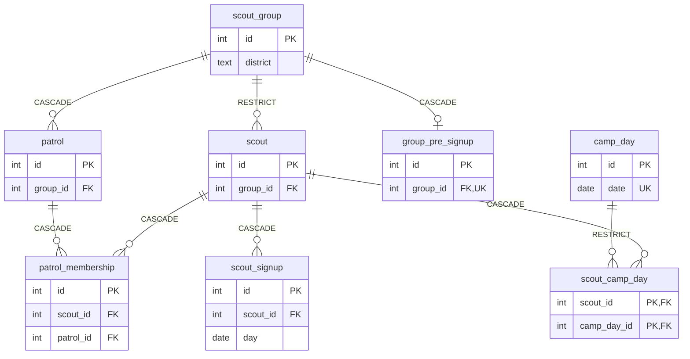

Andre områder refererer til `scout_group`: `asp_net_users.group_id`,
`user_invitation.group_id`, `historic_presignup` og `historic_signup`.

### `scout_group`

En spejdergruppe.

| Kolonne | Type | Null | Default/CHECK | Nøgle/FK |
| --- | --- | --- | --- | --- |
| `id` | `INTEGER` | nej | | PK, ikke identity |
| `name` | `TEXT` | ja | | |
| `district` | `TEXT` | nej | CHECK `DANEHOF`, `FIONIA` | |
| `created_at` | `TIMESTAMPTZ` | nej | `NOW()` | |
| `updated_at` | `TIMESTAMPTZ` | nej | `NOW()` | |
| `deleted_at` | `TIMESTAMPTZ` | ja | | |

**Nøgler og indeks:** `scout_group_pkey` (`id`).

**Regler i koden:** `id` genereres ikke af databasen, men angives ved
oprettelse.

**Soft delete:** ja.

### `scout`

En spejder i en gruppe.

| Kolonne | Type | Null | Default/CHECK | Nøgle/FK |
| --- | --- | --- | --- | --- |
| `id` | `INTEGER` identity | nej | | PK |
| `name` | `TEXT` | ja | | |
| `birthday` | `DATE` | nej | | |
| `gender` | `TEXT` | nej | CHECK `MALE`, `FEMALE` | |
| `group_id` | `INTEGER` | nej | | FK `scout_group.id`, RESTRICT |
| `created_at` | `TIMESTAMPTZ` | nej | `NOW()` | |
| `updated_at` | `TIMESTAMPTZ` | nej | `NOW()` | |
| `deleted_at` | `TIMESTAMPTZ` | ja | | |

**Nøgler og indeks:** `scout_pkey` (`id`); `idx_scout_group_id` (`group_id`).

**Soft delete:** ja.

### `patrol`

En patrulje i en gruppe.

| Kolonne | Type | Null | Default/CHECK | Nøgle/FK |
| --- | --- | --- | --- | --- |
| `id` | `INTEGER` identity | nej | | PK |
| `name` | `TEXT` | ja | | |
| `group_id` | `INTEGER` | nej | | FK `scout_group.id`, CASCADE |

**Nøgler og indeks:** `patrol_pkey` (`id`); `idx_patrol_group_id` (`group_id`).

**Soft delete:** nej.

### `patrol_membership`

En spejders medlemskab af en patrulje.

| Kolonne | Type | Null | Default/CHECK | Nøgle/FK |
| --- | --- | --- | --- | --- |
| `id` | `INTEGER` identity | nej | | PK |
| `scout_id` | `INTEGER` | nej | | FK `scout.id`, CASCADE |
| `patrol_id` | `INTEGER` | nej | | FK `patrol.id`, CASCADE |
| `joined_date` | `TIMESTAMPTZ` | nej | `NOW()` | |
| `is_patrol_leader` | `BOOLEAN` | nej | `FALSE` | |

**Nøgler og indeks:** `patrol_membership_pkey` (`id`); unik
`patrol_membership_scout_id_patrol_id_key` (`scout_id, patrol_id`);
`idx_patrol_membership_patrol_id` (`patrol_id`).

**Soft delete:** nej.

### `group_pre_signup`

Gruppens forhåndstilmelding: forventet antal pr. gren.

| Kolonne | Type | Null | Default/CHECK | Nøgle/FK |
| --- | --- | --- | --- | --- |
| `id` | `INTEGER` identity | nej | | PK |
| `group_id` | `INTEGER` | nej | | FK `scout_group.id`, CASCADE; unik |
| `beaver` | `INTEGER` | nej | `0`, CHECK `>= 0` | |
| `wolf` | `INTEGER` | nej | `0`, CHECK `>= 0` | |
| `junior` | `INTEGER` | nej | `0`, CHECK `>= 0` | |
| `trop` | `INTEGER` | nej | `0`, CHECK `>= 0` | |
| `senior` | `INTEGER` | nej | `0`, CHECK `>= 0` | |
| `rover` | `INTEGER` | nej | `0`, CHECK `>= 0` | |
| `leader` | `INTEGER` | nej | `0`, CHECK `>= 0` | |

**Nøgler og indeks:** `group_pre_signup_pkey` (`id`); unik
`group_pre_signup_group_id_key` (`group_id`), så en gruppe har højst én
forhåndstilmelding.

**Soft delete:** nej.

### `camp_day`

Lejrens dage, som lejrchefen redigerer i lejrindstillingerne.

| Kolonne | Type | Null | Default/CHECK | Nøgle/FK |
| --- | --- | --- | --- | --- |
| `id` | `INTEGER` identity | nej | | PK |
| `date` | `DATE` | nej | | unik |
| `half` | `VARCHAR(16)` | nej | `ck_camp_day_half`: `First`, `Second`, `Both` | |

**Nøgler og indeks:** `camp_day_pkey` (`id`); unik `uq_camp_day_date`
(`date`), så en dato kun kan være én lejrdag.

**Regler:** `Both` markerer en skiftedag, der hører til begge halvdele.

**Soft delete:** nej.

### `scout_camp_day`

De lejrdage, en spejder deltager.

| Kolonne | Type | Null | Default/CHECK | Nøgle/FK |
| --- | --- | --- | --- | --- |
| `scout_id` | `INTEGER` | nej | | PK; FK `scout.id`, CASCADE |
| `camp_day_id` | `INTEGER` | nej | | PK; FK `camp_day.id`, RESTRICT |

**Nøgler og indeks:** `scout_camp_day_pkey` (`scout_id, camp_day_id`), så en
dag kun kan registreres én gang pr. spejder; `ix_scout_camp_day_camp_day_id`
(`camp_day_id`) til opslag pr. dag.

**Regler i koden:** da `scout` soft-slettes, udløses `ON DELETE CASCADE` ikke;
koden fjerner spejderens rækker ved sletning. `RESTRICT` på `camp_day_id`
forhindrer sletning af en lejrdag med tilmeldte spejdere. En spejder uden
rækker mangler at få udfyldt dage; der findes ingen tilstand for "0 dage".

**Soft delete:** nej.

### `scout_signup`

Tilmelding af en spejder til en fri dato. Tabellen er ubrugt og afløst af
`scout_camp_day`; den fjernes i en senere release (expand/contract).

| Kolonne | Type | Null | Default/CHECK | Nøgle/FK |
| --- | --- | --- | --- | --- |
| `id` | `INTEGER` identity | nej | | PK |
| `day` | `DATE` | nej | | |
| `scout_id` | `INTEGER` | nej | | FK `scout.id`, CASCADE |

**Nøgler og indeks:** `scout_signup_pkey` (`id`); unik
`scout_signup_scout_id_day_key` (`scout_id, day`).

**Soft delete:** nej.

## Aktiviteter

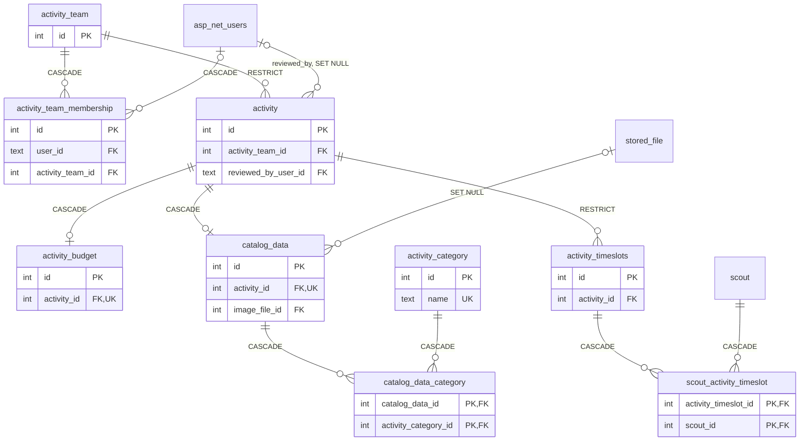

Aktivitetens filer og Google-mappe er beskrevet under
[Filer og Google](#filer-og-google), materialebestillinger under
[Materialer](#materialer).

### `activity_team`

Et aktivitetshold, der arrangerer aktiviteter.

| Kolonne | Type | Null | Default/CHECK | Nøgle/FK |
| --- | --- | --- | --- | --- |
| `id` | `INTEGER` identity | nej | | PK |
| `name` | `TEXT` | ja | | |
| `created_at` | `TIMESTAMPTZ` | nej | `NOW()` | |
| `updated_at` | `TIMESTAMPTZ` | nej | `NOW()` | |
| `deleted_at` | `TIMESTAMPTZ` | ja | | |

**Nøgler og indeks:** `activity_team_pkey` (`id`).

**Soft delete:** ja.

### `activity_team_membership`

En brugers medlemskab af et aktivitetshold.

| Kolonne | Type | Null | Default/CHECK | Nøgle/FK |
| --- | --- | --- | --- | --- |
| `id` | `INTEGER` identity | nej | | PK |
| `user_id` | `TEXT` | ja | | FK `asp_net_users.id`, CASCADE |
| `activity_team_id` | `INTEGER` | nej | | FK `activity_team.id`, CASCADE |
| `is_admin` | `BOOLEAN` | nej | `FALSE` | |

**Nøgler og indeks:** `activity_team_membership_pkey` (`id`); unik
`activity_team_membership_user_id_activity_team_id_key`
(`user_id, activity_team_id`).

**Soft delete:** nej.

### `activity`

En aktivitet med sin godkendelsesstatus. Der er ingen separat historiktabel for
godkendelser; tabellen gemmer seneste vurdering, ikke et fuldt revisionsspor.

| Kolonne | Type | Null | Default/CHECK | Nøgle/FK |
| --- | --- | --- | --- | --- |
| `id` | `INTEGER` identity | nej | | PK |
| `name` | `TEXT` | ja | | |
| `activity_team_id` | `INTEGER` | nej | | FK `activity_team.id`, RESTRICT |
| `review_status` | `VARCHAR(32)` | nej | `'Draft'`; `ck_activity_review_status`: `Draft`, `Submitted`, `ChangesRequested`, `Approved` | |
| `review_version` | `INTEGER` | nej | `0` | |
| `submitted_at` | `TIMESTAMPTZ` | ja | | |
| `reviewed_at` | `TIMESTAMPTZ` | ja | | |
| `reviewed_by_user_id` | `TEXT` | ja | | FK `asp_net_users.id`, SET NULL |
| `review_feedback` | `VARCHAR(4000)` | ja | | |
| `created_at` | `TIMESTAMPTZ` | nej | `NOW()` | |
| `updated_at` | `TIMESTAMPTZ` | nej | `NOW()` | |
| `deleted_at` | `TIMESTAMPTZ` | ja | | |

**Nøgler og indeks:** `activity_pkey` (`id`); `idx_activity_activity_team_id`
(`activity_team_id`); `idx_activity_review_status_submitted_at`
(`review_status, submitted_at`); `idx_activity_reviewed_by_user_id`
(`reviewed_by_user_id`).

**Regler i koden:** `review_version` er EF-concurrency-token ved redigering og
godkendelseshandlinger. `review_feedback` indeholder seneste
tilbagesendelsesbegrundelse; den bevares under rettelser og genindsendelse og
ryddes ved en ny godkendelse. At der kræves en begrundelse ved
tilbagesendelse, håndhæves i applikationen.

**Soft delete:** ja.

### `activity_budget`

Aktivitetens budget.

| Kolonne | Type | Null | Default/CHECK | Nøgle/FK |
| --- | --- | --- | --- | --- |
| `id` | `INTEGER` identity | nej | | PK |
| `budget` | `INTEGER` | nej | `0`, CHECK `>= 0` | |
| `activity_id` | `INTEGER` | nej | | FK `activity.id`, CASCADE; unik |

**Nøgler og indeks:** `activity_budget_pkey` (`id`); unik
`activity_budget_activity_id_key` (`activity_id`).

**Soft delete:** nej.

### `catalog_data`

Aktivitetens katalogtekst og billede.

| Kolonne | Type | Null | Default/CHECK | Nøgle/FK |
| --- | --- | --- | --- | --- |
| `id` | `INTEGER` identity | nej | | PK |
| `name` | `TEXT` | ja | | |
| `summary` | `TEXT` | ja | | |
| `description` | `TEXT` | ja | | |
| `activity_id` | `INTEGER` | nej | | FK `activity.id`, CASCADE; unik |
| `image_file_id` | `INTEGER` | ja | | FK `stored_file.id`, SET NULL |

**Nøgler og indeks:** `catalog_data_pkey` (`id`); unik
`catalog_data_activity_id_key` (`activity_id`).

**Regler:** `SET NULL` på `image_file_id` gør, at en slettet `stored_file`
frigør referencen uden at slette kataloget.

**Soft delete:** nej.

### `activity_category`

En kategori, som katalogdata kan mærkes med.

| Kolonne | Type | Null | Default/CHECK | Nøgle/FK |
| --- | --- | --- | --- | --- |
| `id` | `INTEGER` identity | nej | | PK |
| `name` | `TEXT` | ja | | unik |

**Nøgler og indeks:** `activity_category_pkey` (`id`); unik
`activity_category_name_key` (`name`).

**Soft delete:** nej.

### `catalog_data_category`

Mange-til-mange mellem `catalog_data` og `activity_category`. EF mapper den som
en koblingstabel uden egen entitetsklasse.

| Kolonne | Type | Null | Default/CHECK | Nøgle/FK |
| --- | --- | --- | --- | --- |
| `catalog_data_id` | `INTEGER` | nej | | PK; FK `catalog_data.id`, CASCADE |
| `activity_category_id` | `INTEGER` | nej | | PK; FK `activity_category.id`, CASCADE |

**Nøgler og indeks:** `catalog_data_category_pkey`
(`catalog_data_id, activity_category_id`).

**Soft delete:** nej.

### `activity_timeslots`

Et tidspunkt, hvor en aktivitet afholdes.

| Kolonne | Type | Null | Default/CHECK | Nøgle/FK |
| --- | --- | --- | --- | --- |
| `id` | `INTEGER` identity | nej | | PK |
| `activity_id` | `INTEGER` | nej | | FK `activity.id`, RESTRICT |
| `start_time` | `TIMESTAMPTZ` | nej | | |
| `duration` | `INTEGER` | nej | CHECK `>= 1` | |

**Nøgler og indeks:** `activity_timeslots_pkey` (`id`);
`idx_activity_timeslot_activity_id` (`activity_id`).

**Soft delete:** nej.

### `scout_activity_timeslot`

En spejders tilmelding til et aktivitetstidspunkt. Tabellen findes i
databasen, men har ingen tilsvarende entitet i `DataDbContext`.

| Kolonne | Type | Null | Default/CHECK | Nøgle/FK |
| --- | --- | --- | --- | --- |
| `activity_timeslot_id` | `INTEGER` | nej | | PK; FK `activity_timeslots.id`, CASCADE |
| `scout_id` | `INTEGER` | nej | | PK; FK `scout.id`, CASCADE |

**Nøgler og indeks:** `scout_activity_timeslot_pkey`
(`activity_timeslot_id, scout_id`); `idx_scout_activity_timeslot_scout_id`
(`scout_id`).

**Soft delete:** nej.

## Materialer

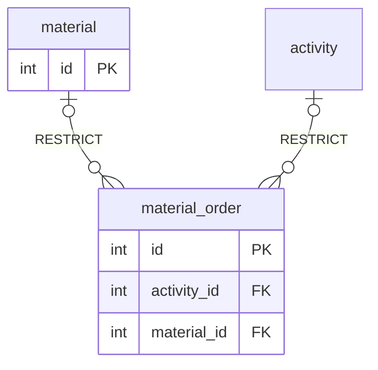

### `material`

Et materiale, der kan bestilles til aktiviteter.

| Kolonne | Type | Null | Default/CHECK | Nøgle/FK |
| --- | --- | --- | --- | --- |
| `id` | `INTEGER` identity | nej | | PK |
| `name` | `TEXT` | ja | | |
| `price` | `NUMERIC(10, 2)` | nej | `0`, CHECK `>= 0` | |
| `url` | `TEXT` | ja | | |
| `created_at` | `TIMESTAMPTZ` | nej | `NOW()` | |
| `updated_at` | `TIMESTAMPTZ` | nej | `NOW()` | |
| `deleted_at` | `TIMESTAMPTZ` | ja | | |

**Nøgler og indeks:** `material_pkey` (`id`).

**Soft delete:** ja.

### `material_order`

En bestilling af et materiale til en aktivitet.

| Kolonne | Type | Null | Default/CHECK | Nøgle/FK |
| --- | --- | --- | --- | --- |
| `id` | `INTEGER` identity | nej | | PK |
| `activity_id` | `INTEGER` | ja | | FK `activity.id`, RESTRICT |
| `material_id` | `INTEGER` | ja | | FK `material.id`, RESTRICT |
| `quantity` | `INTEGER` | nej | `1`, CHECK `> 0` | |
| `use_date` | `TIMESTAMPTZ` | nej | | |
| `created_at` | `TIMESTAMPTZ` | nej | `NOW()` | |
| `updated_at` | `TIMESTAMPTZ` | nej | `NOW()` | |
| `deleted_at` | `TIMESTAMPTZ` | ja | | |

**Nøgler og indeks:** `material_order_pkey` (`id`);
`idx_material_order_activity_id` (`activity_id`);
`idx_material_order_material_id` (`material_id`).

**Regler i koden:** `use_date` mappes til entitetens `OrderedToDate`.

**Soft delete:** ja.

## Filer og Google

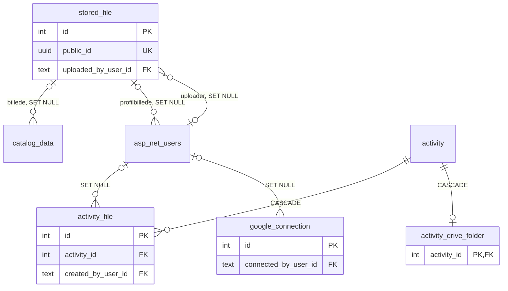

### `stored_file`

En uploadet fil, som systemet selv opbevarer: katalogbilleder og
profilbilleder.

| Kolonne | Type | Null | Default/CHECK | Nøgle/FK |
| --- | --- | --- | --- | --- |
| `id` | `INTEGER` identity | nej | | PK |
| `public_id` | `UUID` | nej | | unik |
| `original_name` | `TEXT` | ja | | |
| `content_type` | `VARCHAR(128)` | nej | | |
| `size_bytes` | `BIGINT` | ja | | |
| `sha256` | `VARCHAR(64)` | ja | | |
| `width` | `INTEGER` | ja | | |
| `height` | `INTEGER` | ja | | |
| `storage_key` | `TEXT` | ja | | |
| `status` | `VARCHAR(16)` | nej | `'Pending'`; CHECK `Pending`, `Processing`, `Ready`, `Failed` | |
| `error` | `TEXT` | ja | | |
| `purpose` | `VARCHAR(32)` | nej | CHECK `CatalogImage`, `ProfilePicture` | |
| `is_public` | `BOOLEAN` | nej | `FALSE` | |
| `uploaded_by_user_id` | `TEXT` | ja | | FK `asp_net_users.id`, SET NULL |
| `created_at` | `TIMESTAMPTZ` | nej | `NOW()` | |
| `updated_at` | `TIMESTAMPTZ` | nej | `NOW()` | |
| `deleted_at` | `TIMESTAMPTZ` | ja | | |

**Nøgler og indeks:** `stored_file_pkey` (`id`); unik
`stored_file_public_id_key` (`public_id`); `idx_stored_file_status`
(`status`); `idx_stored_file_uploaded_by_user_id` (`uploaded_by_user_id`).

**Regler i koden:** `status` styres af konverteringsjobbet: `Pending` ved
upload, `Processing` under konvertering, `Ready` når WebP-filen er skrevet, og
`Failed` med fejltekst i `error`, hvis konverteringen fejler. `storage_key` er
først sat, når rækken er `Ready`; den midlertidige fil ligger under en
`pending/`-nøgle og slettes efter konvertering. `public_id` er det ugættelige
id, som offentlige katalogbilleder betjenes på. `catalog_data.image_file_id` og
`asp_net_users.profile_picture_file_id` peger på tabellen med `SET NULL`.

**Soft delete:** ja.

### `activity_file`

De filer og mapper, systemet har oprettet i Google Drive for en aktivitet.
Bruges til at vise "Oprettet af" i fillisten.

| Kolonne | Type | Null | Default/CHECK | Nøgle/FK |
| --- | --- | --- | --- | --- |
| `id` | `INTEGER` identity | nej | | PK |
| `activity_id` | `INTEGER` | nej | | FK `activity.id`, CASCADE |
| `drive_file_id` | `TEXT` | nej | | |
| `title` | `TEXT` | nej | | |
| `created_by_user_id` | `TEXT` | ja | | FK `asp_net_users.id`, SET NULL |
| `created_at` | `TIMESTAMPTZ` | nej | `NOW()` | |
| `updated_at` | `TIMESTAMPTZ` | nej | `NOW()` | |
| `deleted_at` | `TIMESTAMPTZ` | ja | | |

**Nøgler og indeks:** `activity_file_pkey` (`id`);
`idx_activity_file_activity_id` (`activity_id`).

**Regler i koden:** `drive_file_id` er Drive-filens id, og `title` er titlen
ved oprettelsen. Den viste titel og filtype kommer fra Drive, ikke fra
tabellen. En soft delete sletter eller flytter ikke filen i Drive; kolonnen
findes, men ingen kode sætter den endnu.

**Soft delete:** ja.

### `activity_drive_folder`

Id'et på den Google Drive-mappe, HQ har oprettet for en aktivitet, så mappen
kan flyttes frit i Drive, uden at forbindelsen brydes.

| Kolonne | Type | Null | Default/CHECK | Nøgle/FK |
| --- | --- | --- | --- | --- |
| `activity_id` | `INTEGER` | nej | | PK; FK `activity.id`, CASCADE |
| `drive_folder_id` | `TEXT` | nej | | |
| `created_at` | `TIMESTAMPTZ` | nej | `NOW()` | |
| `updated_at` | `TIMESTAMPTZ` | nej | `NOW()` | |

**Nøgler og indeks:** `activity_drive_folder_pkey` (`activity_id`), så der
højst er én mappe pr. aktivitet.

**Regler i koden:** rækken oprettes første gang mappen slås op eller dannes, og
slettes igen, hvis mappen ikke findes i Drive, så der kan dannes en ny.

**Soft delete:** nej.

### `google_connection`

Den Google-konto, HQ bruger til at oprette Google-filer.

| Kolonne | Type | Null | Default/CHECK | Nøgle/FK |
| --- | --- | --- | --- | --- |
| `id` | `INTEGER` identity | nej | | PK |
| `account_email` | `TEXT` | nej | | |
| `refresh_token` | `TEXT` | nej | | |
| `connected_by_user_id` | `TEXT` | ja | | FK `asp_net_users.id`, SET NULL |
| `created_at` | `TIMESTAMPTZ` | nej | `NOW()` | |
| `updated_at` | `TIMESTAMPTZ` | nej | `NOW()` | |

**Nøgler og indeks:** `google_connection_pkey` (`id`).

**Regler i koden:** `refresh_token` er OAuth-refresh-tokenet krypteret med
ASP.NET Core Data Protection, så værdien kun kan læses af en app-instans med
den rigtige nøglering. Der holdes højst én række ad gangen: ved en ny
forbindelse slettes den gamle. `SET NULL` på `connected_by_user_id` gør, at en
slettet bruger ikke fjerner forbindelsen.

**Soft delete:** nej.

## Brugere og adgang

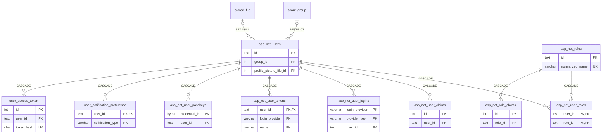

Tabellerne `asp_net_*` er ASP.NET Core Identitys standardtabeller med
DS28-tilføjelser på `asp_net_users`.

### `asp_net_users`

En bruger.

| Kolonne | Type | Null | Default/CHECK | Nøgle/FK |
| --- | --- | --- | --- | --- |
| `id` | `TEXT` | nej | | PK |
| `user_name` | `VARCHAR(256)` | ja | | |
| `normalized_user_name` | `VARCHAR(256)` | ja | | unikt indeks |
| `email` | `VARCHAR(256)` | ja | | |
| `normalized_email` | `VARCHAR(256)` | ja | | |
| `email_confirmed` | `BOOLEAN` | nej | | |
| `password_hash` | `TEXT` | ja | | |
| `security_stamp` | `TEXT` | ja | | |
| `concurrency_stamp` | `TEXT` | ja | | |
| `phone_number` | `VARCHAR(256)` | ja | | |
| `phone_number_confirmed` | `BOOLEAN` | nej | | |
| `two_factor_enabled` | `BOOLEAN` | nej | | |
| `lockout_end` | `TIMESTAMPTZ` | ja | | |
| `lockout_enabled` | `BOOLEAN` | nej | | |
| `access_failed_count` | `INTEGER` | nej | | |
| `first_name` | `TEXT` | ja | | |
| `last_name` | `TEXT` | ja | | |
| `group_id` | `INTEGER` | ja | | FK `scout_group.id`, RESTRICT |
| `has_enabled_authenticator` | `BOOLEAN` | nej | `FALSE` | |
| `profile_picture_file_id` | `INTEGER` | ja | | FK `stored_file.id`, SET NULL |
| `last_login_at` | `TIMESTAMPTZ` | ja | | |
| `last_active_at` | `TIMESTAMPTZ` | ja | | |

**Nøgler og indeks:** `asp_net_users_pkey` (`id`); unik
`idx_asp_net_users_normalized_user_name` (`normalized_user_name`);
`idx_asp_net_users_normalized_email` (`normalized_email`);
`idx_asp_net_users_group_id` (`group_id`).

**Regler i koden:** `group_id` er brugerens spejdergruppe. `last_login_at` er
tidspunktet for seneste vellykkede login; `NULL` betyder, at der ikke er
registreret et login. Der gemmes ingen loginhistorik. `last_active_at` er
tidspunktet for seneste godkendte request med en præcision på op til fem
minutter; `NULL` betyder, at der ikke er registreret aktivitet. Der gemmes
ingen aktivitetslog.

**Soft delete:** nej.

### `asp_net_roles`

En Identity-rolle.

| Kolonne | Type | Null | Default/CHECK | Nøgle/FK |
| --- | --- | --- | --- | --- |
| `id` | `TEXT` | nej | | PK |
| `name` | `VARCHAR(256)` | ja | | |
| `normalized_name` | `VARCHAR(256)` | ja | | unikt indeks |
| `concurrency_stamp` | `TEXT` | ja | | |

**Nøgler og indeks:** `asp_net_roles_pkey` (`id`); unik
`idx_asp_net_roles_normalized_name` (`normalized_name`).

**Regler i koden:** `RoleSeeder` opretter ved opstart en rolle for hver
`AppGroups`-værdi, herunder `McpUser`. Remote MCP kræver, at `McpUser` er
tildelt direkte via `asp_net_user_roles`; administratorroller og
organisationsstillinger giver ikke automatisk adgang.

**Soft delete:** nej.

### `asp_net_user_roles`

Kobling mellem bruger og rolle.

| Kolonne | Type | Null | Default/CHECK | Nøgle/FK |
| --- | --- | --- | --- | --- |
| `user_id` | `TEXT` | nej | | PK; FK `asp_net_users.id`, CASCADE |
| `role_id` | `TEXT` | nej | | PK; FK `asp_net_roles.id`, CASCADE |

**Nøgler og indeks:** `asp_net_user_roles_pkey` (`user_id, role_id`);
`idx_asp_net_user_roles_role_id` (`role_id`).

**Soft delete:** nej.

### `asp_net_user_claims`

Claims på en bruger.

| Kolonne | Type | Null | Default/CHECK | Nøgle/FK |
| --- | --- | --- | --- | --- |
| `id` | `INTEGER` identity by default | nej | | PK |
| `user_id` | `TEXT` | nej | | FK `asp_net_users.id`, CASCADE |
| `claim_type` | `TEXT` | ja | | |
| `claim_value` | `TEXT` | ja | | |

**Nøgler og indeks:** `asp_net_user_claims_pkey` (`id`);
`idx_asp_net_user_claims_user_id` (`user_id`).

**Soft delete:** nej.

### `asp_net_role_claims`

Claims på en rolle.

| Kolonne | Type | Null | Default/CHECK | Nøgle/FK |
| --- | --- | --- | --- | --- |
| `id` | `INTEGER` identity by default | nej | | PK |
| `role_id` | `TEXT` | nej | | FK `asp_net_roles.id`, CASCADE |
| `claim_type` | `TEXT` | ja | | |
| `claim_value` | `TEXT` | ja | | |

**Nøgler og indeks:** `asp_net_role_claims_pkey` (`id`);
`idx_asp_net_role_claims_role_id` (`role_id`).

**Soft delete:** nej.

### `asp_net_user_logins`

Eksterne logins knyttet til en bruger.

| Kolonne | Type | Null | Default/CHECK | Nøgle/FK |
| --- | --- | --- | --- | --- |
| `login_provider` | `VARCHAR(128)` | nej | | PK |
| `provider_key` | `VARCHAR(128)` | nej | | PK |
| `provider_display_name` | `TEXT` | ja | | |
| `user_id` | `TEXT` | nej | | FK `asp_net_users.id`, CASCADE |

**Nøgler og indeks:** `asp_net_user_logins_pkey`
(`login_provider, provider_key`); `idx_asp_net_user_logins_user_id`
(`user_id`).

**Soft delete:** nej.

### `asp_net_user_tokens`

Identitys tokens pr. bruger, for eksempel authenticator-nøgler.

| Kolonne | Type | Null | Default/CHECK | Nøgle/FK |
| --- | --- | --- | --- | --- |
| `user_id` | `TEXT` | nej | | PK; FK `asp_net_users.id`, CASCADE |
| `login_provider` | `VARCHAR(128)` | nej | | PK |
| `name` | `VARCHAR(128)` | nej | | PK |
| `value` | `TEXT` | ja | | |

**Nøgler og indeks:** `asp_net_user_tokens_pkey`
(`user_id, login_provider, name`).

**Soft delete:** nej.

### `asp_net_user_passkeys`

En brugers passkeys.

| Kolonne | Type | Null | Default/CHECK | Nøgle/FK |
| --- | --- | --- | --- | --- |
| `credential_id` | `BYTEA` | nej | | PK |
| `user_id` | `TEXT` | nej | | FK `asp_net_users.id`, CASCADE |
| `data` | `JSONB` | nej | | |

**Nøgler og indeks:** `asp_net_user_passkeys_pkey` (`credential_id`);
`idx_asp_net_user_passkeys_user_id` (`user_id`).

**Regler i koden:** `data` er Identitys passkey-data, mappet som en ejet
entitet i JSON.

**Soft delete:** nej.

### `user_notification_preference`

De notifikationstyper, en bruger abonnerer på.

| Kolonne | Type | Null | Default/CHECK | Nøgle/FK |
| --- | --- | --- | --- | --- |
| `user_id` | `TEXT` | nej | | PK; FK `asp_net_users.id`, CASCADE |
| `notification_type` | `VARCHAR(64)` | nej | | PK |

**Nøgler og indeks:** `user_notification_preference_pkey`
(`user_id, notification_type`).

**Regler i koden:** `notification_type` er navnet på en
`NotificationType`-værdi (`NewUser`, `BoardCreated`); databasen har ingen
CHECK.

**Soft delete:** nej.

### `user_access_token`

Personlige adgangstokens til værktøjer og scripts.

| Kolonne | Type | Null | Default/CHECK | Nøgle/FK |
| --- | --- | --- | --- | --- |
| `id` | `INTEGER` identity | nej | | PK |
| `user_id` | `TEXT` | nej | | FK `asp_net_users.id`, CASCADE |
| `name` | `VARCHAR(64)` | nej | CHECK `length(btrim(name)) > 0` | |
| `token_hash` | `CHAR(64)` | nej | | unik |
| `created_at` | `TIMESTAMPTZ` | nej | `NOW()` | |
| `expires_at` | `TIMESTAMPTZ` | ja | | |
| `revoked_at` | `TIMESTAMPTZ` | ja | | |

**Nøgler og indeks:** `user_access_token_pkey` (`id`); unik
`user_access_token_token_hash_key` (`token_hash`);
`ix_user_access_token_user_id` (`user_id`).

**Regler i koden:** kun SHA-256-hashen i `token_hash` gemmes, så den rå token
ikke kan gendannes fra databasen og kun vises én gang ved oprettelse.
`revoked_at` markerer et tilbagekaldt token, som bliver liggende; tokens
slettes sammen med brugeren.

**Soft delete:** nej.

## Invitationer og indstillinger

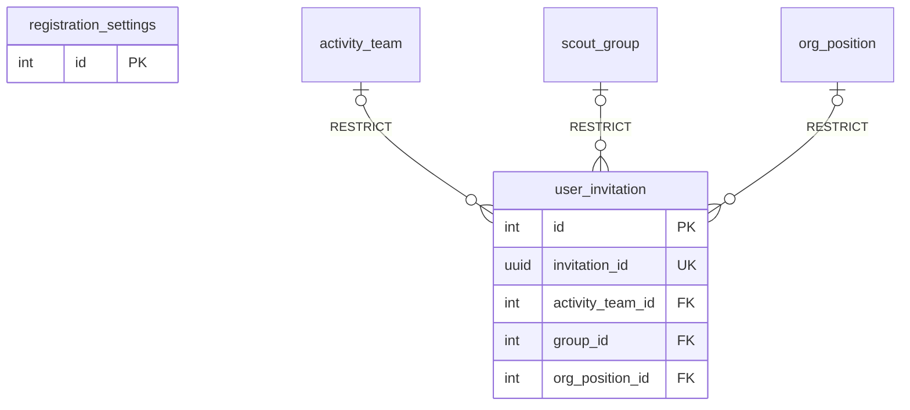

### `user_invitation`

En invitation til at oprette en bruger, eventuelt med roller, gruppe,
aktivitetshold eller organisationsstilling.

| Kolonne | Type | Null | Default/CHECK | Nøgle/FK |
| --- | --- | --- | --- | --- |
| `id` | `INTEGER` identity | nej | | PK |
| `invitation_id` | `UUID` | nej | | unik |
| `email` | `TEXT` | ja | | |
| `roles` | `TEXT[]` | ja | `'{}'` | |
| `used` | `BOOLEAN` | nej | `FALSE` | |
| `activity_team_id` | `INTEGER` | ja | | FK `activity_team.id`, RESTRICT |
| `is_admin` | `BOOLEAN` | nej | `FALSE` | |
| `group_id` | `INTEGER` | ja | | FK `scout_group.id`, RESTRICT |
| `org_position_id` | `INTEGER` | ja | | FK `org_position.id`, RESTRICT |
| `created_at` | `TIMESTAMPTZ` | nej | `NOW()` | |
| `updated_at` | `TIMESTAMPTZ` | nej | `NOW()` | |
| `deleted_at` | `TIMESTAMPTZ` | ja | | |

**Nøgler og indeks:** `user_invitation_pkey` (`id`); unik
`user_invitation_invitation_id_key` (`invitation_id`).

**Regler i koden:** `org_position_id` er den stilling, invitationen gælder.

**Soft delete:** ja.

### `registration_settings`

Lejrens tilmeldingsflag. Tabellen har altid præcis én række.

| Kolonne | Type | Null | Default/CHECK | Nøgle/FK |
| --- | --- | --- | --- | --- |
| `id` | `INTEGER` | nej | `1`, CHECK `id = 1` | PK |
| `is_pre_signup_open` | `BOOLEAN` | nej | `FALSE` | |
| `is_signup_open` | `BOOLEAN` | nej | `FALSE` | |
| `is_activity_wish_round_open` | `BOOLEAN` | nej | `FALSE` | |
| `is_activity_signup_open` | `BOOLEAN` | nej | `FALSE` | |

**Nøgler og indeks:** `registration_settings_pkey` (`id`).

**Regler i koden:** scripts opretter rækken med `id = 1`. Flagene ændres
manuelt i lejrindstillingerne. De to aktivitetsflag styrer endnu ingen adgang,
fordi ønske- og tilmeldingsflowet ikke er bygget.

**Soft delete:** nej.

## Organisation

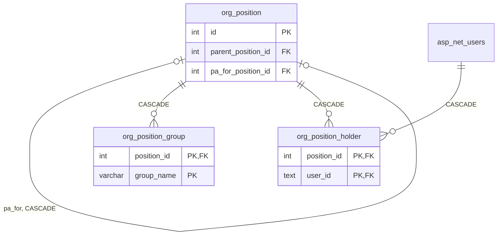

`org_position` refereres desuden af `user_invitation.org_position_id` og
`work_item.owner_position_id`.

### `org_position`

En stilling i organisationsdiagrammet. Stillingerne danner et træ via
`parent_position_id`.

| Kolonne | Type | Null | Default/CHECK | Nøgle/FK |
| --- | --- | --- | --- | --- |
| `id` | `INTEGER` identity | nej | | PK |
| `title` | `VARCHAR(256)` | nej | | |
| `parent_position_id` | `INTEGER` | ja | | FK `org_position.id`, RESTRICT |
| `is_system` | `BOOLEAN` | nej | `FALSE` | |
| `pa_for_position_id` | `INTEGER` | ja | | FK `org_position.id`, CASCADE |
| `color` | `VARCHAR(16)` | ja | | |
| `created_at` | `TIMESTAMPTZ` | nej | `NOW()` | |
| `updated_at` | `TIMESTAMPTZ` | nej | `NOW()` | |
| `deleted_at` | `TIMESTAMPTZ` | ja | | |

**Nøgler og indeks:** `org_position_pkey` (`id`);
`ix_org_position_parent_position_id` (`parent_position_id`); partielt unikt
`uq_org_position_pa_for_position_id` (`pa_for_position_id`
`WHERE deleted_at IS NULL`), som sikrer højst én aktiv personlig assistent pr.
stilling; partielt `ix_org_position_deleted_at` (`deleted_at`
`WHERE deleted_at IS NULL`), som understøtter listen over aktive stillinger.

**Regler i koden:**

- `011_org_positions.sql` opretter systemstillingen "Systemadministrator"
  (`is_system = TRUE`) med gruppen `SysAdmin`; den er beskyttet i koden.
- `pa_for_position_id` knytter en "Personlig assistent"-stilling til dens
  ejerstilling. En sådan stilling har ingen understillinger og kan ikke ændres
  eller flyttes. Den oprettes med gruppen `PersonalAssistant` og arver desuden
  ejerstillingens grupper i den effektive adgang.
- Effektiv adgang opløses dynamisk som Identity-roller plus stillingernes
  grupper; stillingernes grupper kopieres ikke til `asp_net_user_roles`.
- Når en stilling soft-slettes, soft-slettes dens personlige assistent sammen
  med den i `OrgService`.
- `color` er en hex-værdi fra en fast palette, som vises som en lys
  baggrundstone på kortet i organisationsdiagrammet. Paletten håndhæves i
  `OrgService`, ikke i databasen.

**Soft delete:** ja.

### `org_position_group`

De `AppGroups`, en stilling giver adgang til.

| Kolonne | Type | Null | Default/CHECK | Nøgle/FK |
| --- | --- | --- | --- | --- |
| `position_id` | `INTEGER` | nej | | PK; FK `org_position.id`, CASCADE |
| `group_name` | `VARCHAR(64)` | nej | | PK |

**Nøgler og indeks:** `org_position_group_pkey` (`position_id, group_name`).

**Regler i koden:** `McpUser` kan ikke gives via en stilling, kun ved direkte
rolletildeling.

**Soft delete:** nej. Rækkerne bliver liggende, når stillingen soft-slettes.

### `org_position_holder`

Kobling mellem brugere og de stillinger, de beklæder (mange-til-mange).

| Kolonne | Type | Null | Default/CHECK | Nøgle/FK |
| --- | --- | --- | --- | --- |
| `position_id` | `INTEGER` | nej | | PK; FK `org_position.id`, CASCADE |
| `user_id` | `TEXT` | nej | | PK; FK `asp_net_users.id`, CASCADE |

**Nøgler og indeks:** `org_position_holder_pkey` (`position_id, user_id`);
`ix_org_position_holder_user_id` (`user_id`).

**Soft delete:** nej.

## Projektstyring

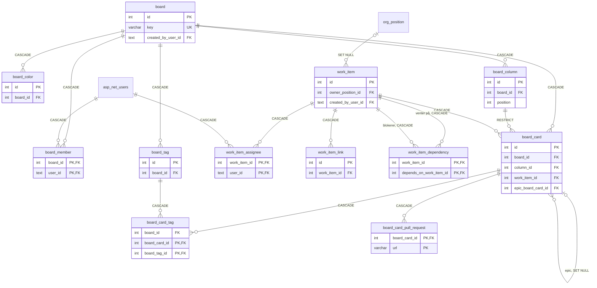

Et `work_item` er selve kortet. `board_card` er en placering af kortet på en
tavle; et kort kan ligge på flere tavler med én placering pr. tavle. Kortets
status er placeringsbestemt og er lig placeringens kolonne. Der findes ikke et
globalt færdig-flag på `work_item`.

### `board`

En tavle.

| Kolonne | Type | Null | Default/CHECK | Nøgle/FK |
| --- | --- | --- | --- | --- |
| `id` | `INTEGER` identity | nej | | PK |
| `key` | `VARCHAR(64)` | nej | | unik |
| `title` | `VARCHAR(256)` | nej | | |
| `description` | `TEXT` | ja | | |
| `icon` | `VARCHAR(64)` | ja | | |
| `color` | `VARCHAR(16)` | ja | | |
| `is_archived` | `BOOLEAN` | nej | `FALSE` | |
| `is_developer_board` | `BOOLEAN` | nej | `FALSE` | |
| `created_by_user_id` | `TEXT` | ja | | FK `asp_net_users.id`, SET NULL |
| `created_at` | `TIMESTAMPTZ` | nej | `NOW()` | |
| `updated_at` | `TIMESTAMPTZ` | nej | `NOW()` | |
| `deleted_at` | `TIMESTAMPTZ` | ja | | |

**Nøgler og indeks:** `board_pkey` (`id`); unik `board_key_key` (`key`).

**Regler i koden:** tavler har ingen rollekrav i databasen. Medlemmer kan læse,
redigere og invitere eksisterende brugere; SysAdmin og CampAdmin har samme
adgang til alle ikke-slettede tavler uden medlemskab. En soft delete af en
tavle sætter kun `deleted_at`; `board_color`, `board_member`, `board_column`,
`board_card` og `work_item_link` bevares. De slettes hårdt, når de fjernes
enkeltvis eller via `ON DELETE CASCADE` fra en hårdt slettet tavle eller et
hårdt slettet kort.

**Soft delete:** ja.

### `board_member`

Medlemsadgang til en tavle.

| Kolonne | Type | Null | Default/CHECK | Nøgle/FK |
| --- | --- | --- | --- | --- |
| `board_id` | `INTEGER` | nej | | PK; FK `board.id`, CASCADE |
| `user_id` | `TEXT` | nej | | PK; FK `asp_net_users.id`, CASCADE |

**Nøgler og indeks:** `board_member_pkey` (`board_id, user_id`), som
forhindrer dobbelt medlemskab; `ix_board_member_user_id` (`user_id`) til opslag
af brugerens tavler.

**Regler i koden:** der er ingen medlemsroller.

**Soft delete:** nej.

### `board_color`

Tavlens navngivne farvepalette.

| Kolonne | Type | Null | Default/CHECK | Nøgle/FK |
| --- | --- | --- | --- | --- |
| `id` | `INTEGER` identity | nej | | PK |
| `board_id` | `INTEGER` | nej | | FK `board.id`, CASCADE |
| `name` | `VARCHAR(64)` | nej | CHECK `length(btrim(name)) > 0` | |
| `color` | `VARCHAR(7)` | nej | CHECK `color ~ '^#[0-9a-f]{6}$'` | |

**Nøgler og indeks:** `board_color_pkey` (`id`); `ix_board_color_board_id`
(`board_id`).

**Regler:** der er ingen unikhedskrav på navn eller farve, ingen fast grænse
på antallet af rækker og ingen relation til kort. En paletteændring ændrer
ikke eksisterende kort.

**Soft delete:** nej.

### `board_column`

En kolonne på en tavle.

| Kolonne | Type | Null | Default/CHECK | Nøgle/FK |
| --- | --- | --- | --- | --- |
| `id` | `INTEGER` identity | nej | | PK |
| `board_id` | `INTEGER` | nej | | FK `board.id`, CASCADE |
| `title` | `VARCHAR(256)` | nej | | |
| `position` | `INTEGER` | nej | | |
| `wip_limit` | `INTEGER` | ja | CHECK `>= 1` | |
| `is_done_column` | `BOOLEAN` | nej | `FALSE` | |
| `created_at` | `TIMESTAMPTZ` | nej | `NOW()` | |
| `updated_at` | `TIMESTAMPTZ` | nej | `NOW()` | |

**Nøgler og indeks:** `board_column_pkey` (`id`); unik
`board_column_board_id_position_key` (`board_id, position`).

**Regler i koden:** `is_done_column` markerer de kolonner, der tæller som
færdige, så "færdig" gælder pr. tavle.

**Soft delete:** nej.

### `board_tag`

Tavlens tags.

| Kolonne | Type | Null | Default/CHECK | Nøgle/FK |
| --- | --- | --- | --- | --- |
| `id` | `INTEGER` identity | nej | | PK |
| `board_id` | `INTEGER` | nej | | FK `board.id`, CASCADE |
| `name` | `VARCHAR(64)` | nej | CHECK `length(btrim(name)) > 0` | |
| `color` | `VARCHAR(7)` | ja | CHECK `color ~ '^#[0-9a-f]{6}$'` | |

**Nøgler og indeks:** `board_tag_pkey` (`id`); alternativ nøgle
`ak_board_tag_board_id_id` (`board_id, id`) til tavleafgrænsede referencer fra
`board_card_tag`; unikt udtryksindeks `ux_board_tag_board_name`
(`board_id, lower(name)`), så navnet er entydigt inden for tavlen uden forskel
på store og små bogstaver.

**Regler:** `NULL` i `color` betyder ingen farve.

**Soft delete:** nej.

### `work_item`

Et kort med indhold, der deles af alle kortets tavleplaceringer.

| Kolonne | Type | Null | Default/CHECK | Nøgle/FK |
| --- | --- | --- | --- | --- |
| `id` | `INTEGER` identity | nej | | PK |
| `title` | `VARCHAR(256)` | nej | | |
| `description` | `TEXT` | ja | | |
| `owner_position_id` | `INTEGER` | ja | | FK `org_position.id`, SET NULL |
| `due_date` | `DATE` | ja | | |
| `priority` | `INTEGER` | nej | `0` | |
| `created_by_user_id` | `TEXT` | ja | | FK `asp_net_users.id`, SET NULL |
| `color` | `VARCHAR(7)` | ja | `work_item_color_check`: `color ~ '^#[0-9a-f]{6}$'` | |
| `created_at` | `TIMESTAMPTZ` | nej | `NOW()` | |
| `updated_at` | `TIMESTAMPTZ` | nej | `NOW()` | |
| `deleted_at` | `TIMESTAMPTZ` | ja | | |

**Nøgler og indeks:** `work_item_pkey` (`id`).

**Regler:** `color` har ingen standardværdi; `NULL` betyder ingen farve.
Farven tilhører kortet, ikke dets tavleplacering, og refererer ikke til
`board_color`. Når et kort soft-slettes, slettes dets rækker i
`work_item_dependency` hårdt i samme transaktion.

**Soft delete:** ja.

### `work_item_assignee`

Kortets ansvarlige brugere.

| Kolonne | Type | Null | Default/CHECK | Nøgle/FK |
| --- | --- | --- | --- | --- |
| `work_item_id` | `INTEGER` | nej | | PK; FK `work_item.id`, CASCADE |
| `user_id` | `TEXT` | nej | | PK; FK `asp_net_users.id`, CASCADE |
| `completed_at` | `TIMESTAMPTZ` | ja | | |

**Nøgler og indeks:** `work_item_assignee_pkey` (`work_item_id, user_id`), som
forhindrer dubletter; `ix_work_item_assignees_user_id` (`user_id`) til opslag
af brugerens opgaver.

**Regler i koden:** tildelinger er fælles for kortets tavleplaceringer og
giver ikke tavleadgang. `completed_at` er tidspunktet, hvor den ansvarlige
klarmeldte sin del af kortet; `NULL` betyder ikke klarmeldt. Klarmeldingen
hører til tildelingen og forsvinder, når den ansvarlige fjernes fra kortet.

**Soft delete:** nej.

### `work_item_link`

Polymorf kobling fra et kort til et domæneobjekt, for eksempel en `Activity`.

| Kolonne | Type | Null | Default/CHECK | Nøgle/FK |
| --- | --- | --- | --- | --- |
| `id` | `INTEGER` identity | nej | | PK |
| `work_item_id` | `INTEGER` | nej | | FK `work_item.id`, CASCADE |
| `entity_type` | `VARCHAR(64)` | nej | | |
| `entity_id` | `INTEGER` | nej | | |

**Nøgler og indeks:** `work_item_link_pkey` (`id`); unik
`work_item_link_work_item_id_entity_type_entity_id_key`
(`work_item_id, entity_type, entity_id`), som forhindrer dobbelte links;
`ix_work_item_link_entity` (`entity_type, entity_id`) til opslag fra
domænesiden.

**Regler i koden:** `entity_id` har ingen fremmednøgle, da koblingen er
polymorf; døde links ryddes i koden.

**Soft delete:** nej.

### `work_item_dependency`

At kortet `work_item_id` venter på kortet `depends_on_work_item_id`.

| Kolonne | Type | Null | Default/CHECK | Nøgle/FK |
| --- | --- | --- | --- | --- |
| `work_item_id` | `INTEGER` | nej | `ck_work_item_dependency_not_self`: `work_item_id <> depends_on_work_item_id` | PK; FK `work_item.id`, CASCADE |
| `depends_on_work_item_id` | `INTEGER` | nej | | PK; FK `work_item.id`, CASCADE |

**Nøgler og indeks:** `work_item_dependency_pkey`
(`work_item_id, depends_on_work_item_id`), som forhindrer dubletter;
`ix_work_item_dependency_depends_on_work_item_id` (`depends_on_work_item_id`)
til opslag af de kort, et kort blokerer.

**Regler i koden:** ringe på tværs af flere rækker afvises i koden, ikke i
databasen. Relationen tilhører kortet, ikke en tavleplacering.

**Soft delete:** nej.

### `board_card`

En placering af et `work_item` på en tavle.

| Kolonne | Type | Null | Default/CHECK | Nøgle/FK |
| --- | --- | --- | --- | --- |
| `id` | `INTEGER` identity | nej | | PK |
| `board_id` | `INTEGER` | nej | | FK `board.id`, CASCADE |
| `column_id` | `INTEGER` | nej | | FK `board_column.id`, RESTRICT |
| `work_item_id` | `INTEGER` | nej | | FK `work_item.id`, CASCADE |
| `position` | `INTEGER` | nej | | |
| `is_epic` | `BOOLEAN` | nej | `FALSE` | |
| `epic_board_card_id` | `INTEGER` | ja | `ck_board_card_epic_not_self`: `epic_board_card_id <> id` | FK `board_card.id`, SET NULL |

**Nøgler og indeks:** `board_card_pkey` (`id`); unik
`board_card_work_item_id_board_id_key` (`work_item_id, board_id`), så et kort
højst har én placering pr. tavle; alternativ nøgle `ak_board_card_board_id_id`
(`board_id, id`) til `board_card_tag`; `ix_board_card_board_id` (`board_id`);
`ix_board_card_column_id` (`column_id`); `ix_board_card_epic_board_card_id`
(`epic_board_card_id`) til opslag af en epics kort.

**Regler i koden:**

- At `column_id` tilhører samme tavle som placeringen, håndhæves i koden.
- `is_epic` markerer placeringen som epic, og `epic_board_card_id` peger på
  den epic, placeringen hører til. `SET NULL` slipper kortene, når epic'ens
  placering slettes. At epic og kort ligger på samme tavle, at målet er
  markeret som epic, og at der kun er ét niveau, håndhæves i koden. Begge
  kolonner bruges kun på udviklertavler; deaktivering af udviklerfunktionen
  bevarer værdierne.

**Soft delete:** nej.

### `board_card_tag`

Tags på en bestemt tavleplacering.

| Kolonne | Type | Null | Default/CHECK | Nøgle/FK |
| --- | --- | --- | --- | --- |
| `board_id` | `INTEGER` | nej | | del af begge sammensatte FK |
| `board_card_id` | `INTEGER` | nej | | PK; FK (`board_id, board_card_id`) til `board_card(board_id, id)`, CASCADE |
| `board_tag_id` | `INTEGER` | nej | | PK; FK (`board_id, board_tag_id`) til `board_tag(board_id, id)`, CASCADE |

**Nøgler og indeks:** `board_card_tag_pkey` (`board_card_id, board_tag_id`),
som forhindrer dobbelt tildeling; `ix_board_card_tag_board_id_board_card_id`
(`board_id, board_card_id`); `ix_board_card_tag_board_id_board_tag_id`
(`board_id, board_tag_id`).

**Regler:** de sammensatte fremmednøgler gør, at databasen afviser tildeling
af et tag fra en anden tavle. Sletning af en tagdefinition eller en placering
fjerner dens tildelinger; et delt `work_item` bevares.

**Soft delete:** nej.

### `board_card_pull_request`

GitHub-pull-request-links på en tavleplacering.

| Kolonne | Type | Null | Default/CHECK | Nøgle/FK |
| --- | --- | --- | --- | --- |
| `board_card_id` | `INTEGER` | nej | | PK; FK `board_card.id`, CASCADE |
| `url` | `VARCHAR(512)` | nej | | PK |

**Nøgler og indeks:** `board_card_pull_request_pkey` (`board_card_id, url`),
så et link er entydigt inden for placeringen.

**Regler i koden:** bruges på udviklertavler; deaktivering af
udviklerfunktionen bevarer rækkerne.

**Soft delete:** nej.

## Historiske tilmeldinger

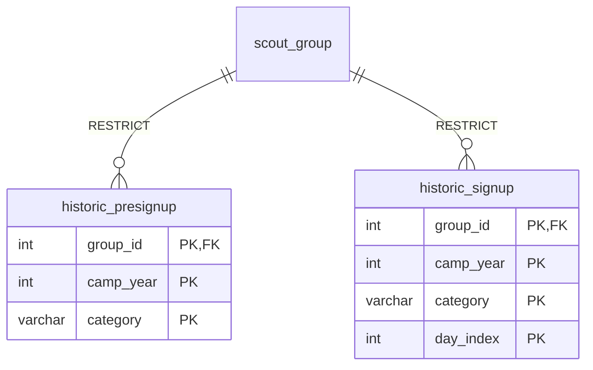

Historikken ligger separat fra aktive tilmeldinger og bruger eksisterende
`scout_group.id`. `RESTRICT` gør, at grupper med historik ikke kan
hard-slettes. Ingen historiske personer eller brugere oprettes, og tabellerne
har ingen persondatafelter. Deltagerantal er aggregerede tilmeldinger, ikke et
verificeret antal unikke personer. Importeren erstatter kun det angivne
lejrårs historik i én transaktion.

### `historic_presignup`

Historisk forhåndstilmelding: én række pr. gruppe, lejrår og gren.

| Kolonne | Type | Null | Default/CHECK | Nøgle/FK |
| --- | --- | --- | --- | --- |
| `group_id` | `INTEGER` | nej | | PK; FK `scout_group.id`, RESTRICT |
| `camp_year` | `INTEGER` | nej | CHECK `BETWEEN 1900 AND 9999` | PK |
| `category` | `VARCHAR(16)` | nej | CHECK `family`, `beaver`, `wolf`, `junior`, `trop`, `senior`, `rover`, `leader` | PK |
| `participant_count` | `INTEGER` | nej | CHECK `>= 0` | |
| `guest_count` | `INTEGER` | nej | CHECK `>= 0` | |
| `source_document_id` | `TEXT` | nej | | |
| `source_sha256` | `VARCHAR(64)` | nej | CHECK `~ '^[0-9a-f]{64}$'` | |
| `imported_at` | `TIMESTAMPTZ` | nej | | |

**Nøgler og indeks:** `historic_presignup_pkey`
(`group_id, camp_year, category`); unik
`historic_presignup_camp_year_source_document_id_category_key`
(`camp_year, source_document_id, category`), så samme kildegren ikke kobles
til flere grupper.

**Regler:** `participant_count` er gruppens antal for grenen. `guest_count` er
venskabsgruppens antal for grenen, særskilt fra værtsgruppens antal.
`source_document_id` er Firestore-dokument-id'et i den tilhørende samling, og
`source_sha256` er kontrolsummen af normaliserede Firebase-data, kildeprojekt
og lejrår. `imported_at` er seneste importtidspunkt.

**Soft delete:** nej.

### `historic_signup`

Historisk tilmelding pr. gruppe, lejrår, gren og dag.

| Kolonne | Type | Null | Default/CHECK | Nøgle/FK |
| --- | --- | --- | --- | --- |
| `group_id` | `INTEGER` | nej | | PK; FK `scout_group.id`, RESTRICT |
| `camp_year` | `INTEGER` | nej | CHECK `BETWEEN 1900 AND 9999` | PK |
| `category` | `VARCHAR(16)` | nej | CHECK `family`, `beaver`, `wolf`, `junior`, `trop`, `senior`, `rover`, `leader` | PK |
| `participant_count` | `INTEGER` | nej | CHECK `>= 0` | |
| `day_index` | `INTEGER` | nej | CHECK `BETWEEN 0 AND 8` | PK |
| `source_document_id` | `TEXT` | nej | | |
| `source_sha256` | `VARCHAR(64)` | nej | CHECK `~ '^[0-9a-f]{64}$'` | |
| `imported_at` | `TIMESTAMPTZ` | nej | | |

**Nøgler og indeks:** `historic_signup_pkey`
(`group_id, camp_year, category, day_index`); unik constraint med
autogenereret, forkortet navn på
(`camp_year, source_document_id, category, day_index`), så hver kilde er unik
pr. dag.

**Regler:** dag 0 indeholder patruljesummer for grenen, ikke summen af dag
1-8. Dag 1-8 svarer for 2024 til lørdag start til lørdag slut. Særskilte
ledertal uden fremmødedage har kun dag 0. En manglende dagsrække betyder ukendt
fremmøde; en eksisterende række med nul betyder registreret nul.

**Soft delete:** nej.

## OpenIddict

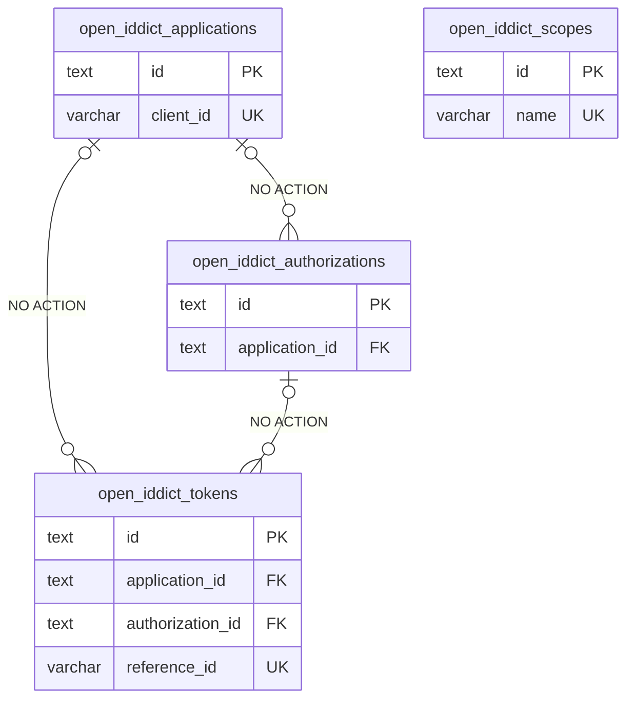

OpenIddicts standardentiteter, mappet til snake_case-tabeller. Alle kolonner
undtagen `id` er nullable. Fremmednøglerne har ingen `ON DELETE`-handling.

Refresh-tokens og deres status og udløb gemmes i `open_iddict_tokens` og
`open_iddict_authorizations`; der er ingen særskilt tabel til MCP-login.
Recurring-jobbet `prune-openiddict` kører dagligt kl. 03:00 UTC og kalder
OpenIddicts `PruneAsync`, som sletter ugyldige eller udløbne tokens og
autorisationer, der er mindst syv dage gamle.

### `open_iddict_applications`

OAuth/OIDC-klienter.

| Kolonne | Type | Null | Default/CHECK | Nøgle/FK |
| --- | --- | --- | --- | --- |
| `id` | `TEXT` | nej | | PK |
| `application_type` | `VARCHAR(50)` | ja | | |
| `client_id` | `VARCHAR(100)` | ja | | unikt indeks |
| `client_secret` | `TEXT` | ja | | |
| `client_type` | `VARCHAR(50)` | ja | | |
| `concurrency_token` | `VARCHAR(50)` | ja | | |
| `consent_type` | `VARCHAR(50)` | ja | | |
| `display_name` | `TEXT` | ja | | |
| `display_names` | `TEXT` | ja | | |
| `json_web_key_set` | `TEXT` | ja | | |
| `permissions` | `TEXT` | ja | | |
| `post_logout_redirect_uris` | `TEXT` | ja | | |
| `properties` | `TEXT` | ja | | |
| `redirect_uris` | `TEXT` | ja | | |
| `requirements` | `TEXT` | ja | | |
| `settings` | `TEXT` | ja | | |

**Nøgler og indeks:** `open_iddict_applications_pkey` (`id`); unik
`ix_open_iddict_applications_client_id` (`client_id`).

**Regler i koden:**

- `permissions` indeholder OpenIddicts JSON-array af klientrettigheder som
  tekst. Authorization-code-klienter har både `gt:authorization_code` og
  `gt:refresh_token`.
- `properties` er OpenIddicts JSON-propertybag. Nøglen
  `ds28:required_app_roles` indeholder et JSON-array af `AppRoles`-navne, og
  mindst én af dem kræves for klientens login. Klientadministrationen kræver
  et ikke-tomt, gyldigt valg og bevarer øvrige properties. Mangler nøglen,
  gælder `WordPressEditor` eller `WordPressAdmin` som standard; en
  tilstedeværende, men tom eller ugyldig værdi afviser login. Der findes ingen
  særskilt tabel eller kolonne til loginrettigheder.

**Soft delete:** nej.

### `open_iddict_scopes`

OAuth-scopes.

| Kolonne | Type | Null | Default/CHECK | Nøgle/FK |
| --- | --- | --- | --- | --- |
| `id` | `TEXT` | nej | | PK |
| `concurrency_token` | `VARCHAR(50)` | ja | | |
| `description` | `TEXT` | ja | | |
| `descriptions` | `TEXT` | ja | | |
| `display_name` | `TEXT` | ja | | |
| `display_names` | `TEXT` | ja | | |
| `name` | `VARCHAR(200)` | ja | | unikt indeks |
| `properties` | `TEXT` | ja | | |
| `resources` | `TEXT` | ja | | |

**Nøgler og indeks:** `open_iddict_scopes_pkey` (`id`); unik
`ix_open_iddict_scopes_name` (`name`).

**Soft delete:** nej.

### `open_iddict_authorizations`

Autorisationer, som en bruger har givet en klient.

| Kolonne | Type | Null | Default/CHECK | Nøgle/FK |
| --- | --- | --- | --- | --- |
| `id` | `TEXT` | nej | | PK |
| `application_id` | `TEXT` | ja | | FK `open_iddict_applications.id` |
| `concurrency_token` | `VARCHAR(50)` | ja | | |
| `creation_date` | `TIMESTAMPTZ` | ja | | |
| `properties` | `TEXT` | ja | | |
| `scopes` | `TEXT` | ja | | |
| `status` | `VARCHAR(50)` | ja | | |
| `subject` | `VARCHAR(400)` | ja | | |
| `type` | `VARCHAR(50)` | ja | | |

**Nøgler og indeks:** `open_iddict_authorizations_pkey` (`id`);
`ix_open_iddict_authorizations_application_id_status_subject_ty`
(`application_id, status, subject, type`).

**Soft delete:** nej.

### `open_iddict_tokens`

Udstedte tokens, herunder refresh-tokens.

| Kolonne | Type | Null | Default/CHECK | Nøgle/FK |
| --- | --- | --- | --- | --- |
| `id` | `TEXT` | nej | | PK |
| `application_id` | `TEXT` | ja | | FK `open_iddict_applications.id` |
| `authorization_id` | `TEXT` | ja | | FK `open_iddict_authorizations.id` |
| `concurrency_token` | `VARCHAR(50)` | ja | | |
| `creation_date` | `TIMESTAMPTZ` | ja | | |
| `expiration_date` | `TIMESTAMPTZ` | ja | | |
| `payload` | `TEXT` | ja | | |
| `properties` | `TEXT` | ja | | |
| `redemption_date` | `TIMESTAMPTZ` | ja | | |
| `reference_id` | `VARCHAR(100)` | ja | | unikt indeks |
| `status` | `VARCHAR(50)` | ja | | |
| `subject` | `VARCHAR(400)` | ja | | |
| `type` | `VARCHAR(150)` | ja | | |

**Nøgler og indeks:** `open_iddict_tokens_pkey` (`id`);
`ix_open_iddict_tokens_application_id_status_subject_type`
(`application_id, status, subject, type`);
`ix_open_iddict_tokens_authorization_id` (`authorization_id`); unik
`ix_open_iddict_tokens_reference_id` (`reference_id`).

**Soft delete:** nej.

## Hangfire

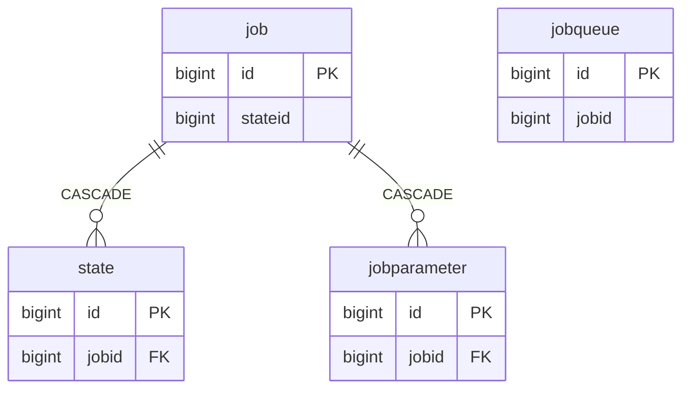

Skemaet `hangfire` ejes af DbUp, ikke af Hangfire. `007_hangfire.sql`
vendorer Hangfire.PostgreSql-installationsscripts `Install.v3` til
`Install.v23` (version 1.21.1) med de versionsopdateringer, som Hangfires
installer ellers udfører mellem scripts. `PrepareSchemaIfNecessary = false` i
`DS.Infrastructure/ConfigureInfrastructure.cs` forhindrer Hangfire i selv at
ændre skemaet. Kolonner, typer og indeks fremgår af `007_hangfire.sql`.

| Tabel | Indhold |
| --- | --- |
| `schema` | Én række med installationsversionen (`23`) |
| `job` | Jobs med `invocationdata` og `arguments` som JSONB |
| `state` | Jobbets tilstandshistorik; FK `jobid` til `job.id` med `ON DELETE CASCADE` og `ON UPDATE CASCADE` |
| `jobparameter` | Jobparametre; FK `jobid` til `job.id` med `ON DELETE CASCADE` og `ON UPDATE CASCADE` |
| `jobqueue` | Køposter; `jobid` har ingen fremmednøgle |
| `server` | Aktive Hangfire-servere med heartbeat |
| `lock` | Distribuerede låse, unik på `resource` |
| `set`, `hash`, `list` | Hangfires nøgle-/værdilagring, blandt andet recurring jobs |
| `counter`, `aggregatedcounter` | Tællere til dashboardets statistik |

Mails sendes som Hangfire-jobs uden outbox-tabel: hver mail enqueues direkte
med modtager, emne og tekst som job-argumenter i `hangfire.job.arguments`.
Fejlede mails ligger som Failed-jobs i dashboardet med exception og kan
genkøes manuelt. `DS.Worker` udfører jobs og registrerer recurring jobs;
Website lægger kun jobs i kø.

### Vedligehold

`hangfire.schema.version` skal svare til de installerede scripts; hæves den
ikke korrekt, springer Hangfires egne install-scripts (`version >= N`) over
eller fejler. Ved opgradering af Hangfire.PostgreSql tilføjes et nyt
migrationsscript med de nye install-scripts og den tilhørende
versionsopdatering.
